# EcoTech — DER do banco (MySQL 8)

17 tabelas, mesmas do documento do backend. O diagrama abaixo renderiza no GitHub e no editor do VS Code (Mermaid). A fonte em texto é `docs/der.mmd`; a página `modelo_bd.html` mostra o mesmo diagrama.

```mermaid
erDiagram
    empresa ||--o{ ecoponto : "possui"
    ecoponto ||--o{ ecoponto_categoria : "aceita"
    categoria_material ||--o{ ecoponto_categoria : "é aceita em"
    pessoa ||--o{ sessao_ecoponto : "abre"
    ecoponto ||--o{ sessao_ecoponto : "recebe"
    pessoa ||--o{ coleta : "realiza"
    ecoponto ||--o{ coleta : "registra"
    sessao_ecoponto |o--o{ coleta : "origina"
    coleta ||--|{ coleta_item : "contém"
    categoria_material ||--o{ coleta_item : "classifica"
    categoria_material ||--o{ produto_catalogo : "agrupa"
    pessoa ||--o{ leitura_codigo : "recebe"
    ecoponto |o--o{ leitura_codigo : "lê em"
    sessao_ecoponto |o--o{ leitura_codigo : "dentro de"
    produto_catalogo |o--o{ leitura_codigo : "identifica"
    pessoa ||--o{ movimento_coins : "tem no ledger"
    pessoa ||--o{ resgate : "faz"
    recompensa ||--o{ resgate : "é trocada em"
    pessoa |o--o{ desafio_verificacao : "responde"
    pessoa |o--o{ log_autenticacao : "gera"
    empresa |o--o{ log_autenticacao : "gera"
    pessoa ||..o{ token_acesso : "conta_tipo = pessoa"
    empresa ||..o{ token_acesso : "conta_tipo = empresa"

    pessoa {
        bigint id PK
        varchar nome "15 a 80 caracteres"
        varchar email UK
        char11 cpf UK "só dígitos"
        char6 login UK "6 letras"
        varchar senha_hash
        varchar nome_mae
        date nascimento
        enum sexo
        varchar telefone_celular
        varchar telefone_fixo
        char8 cep
        varchar logradouro
        varchar numero
        varchar bairro
        varchar cidade
        char2 uf
        enum perfil "comum | master"
        varchar avatar_url
        bigint saldo_coins "cache do ledger, nunca negativo"
        datetime termos_aceitos_em
        boolean ativo
        datetime criado_em
        datetime atualizado_em
    }
    empresa {
        bigint id PK
        char14 cnpj UK
        varchar nome_empresa
        varchar razao_social
        varchar email UK
        varchar senha_hash
        varchar endereco
        enum status "ativa | suspensa"
        datetime criado_em
        datetime atualizado_em
    }
    ecoponto {
        bigint id PK
        bigint empresa_id FK
        varchar codigo UK "ex.: ECO-01"
        varchar nome
        varchar descricao
        varchar endereco
        varchar cidade
        varchar estado
        decimal lat "-90 a 90"
        decimal lng "-180 a 180"
        enum status "ativo | manutencao | inativo"
        char64 segredo_qr "assinatura do QR"
        datetime criado_em
        datetime atualizado_em
    }
    categoria_material {
        bigint id PK
        varchar chave UK "metal, papel, vidro..."
        varchar rotulo
        char7 cor_hex
        int coins_por_unidade
        enum unidade "kg | un"
        datetime criado_em
        datetime atualizado_em
    }
    ecoponto_categoria {
        bigint ecoponto_id PK, FK
        bigint categoria_id PK, FK
        datetime criado_em
        datetime atualizado_em
    }
    sessao_ecoponto {
        bigint id PK
        bigint ecoponto_id FK
        bigint pessoa_id FK
        char64 token UK
        enum status "ativa | encerrada | expirada"
        datetime iniciada_em
        datetime expira_em
        datetime encerrada_em
        datetime criado_em
        datetime atualizado_em
    }
    coleta {
        bigint id PK
        bigint pessoa_id FK
        bigint ecoponto_id FK
        bigint sessao_id FK "opcional"
        enum tipo "checkin | entrega"
        int total_coins
        decimal total_kg
        datetime criado_em
        datetime atualizado_em
    }
    coleta_item {
        bigint id PK
        bigint coleta_id FK
        bigint categoria_id FK
        decimal quantidade "maior que 0"
        int coins
        datetime criado_em
        datetime atualizado_em
    }
    produto_catalogo {
        varchar14 codigo_barras PK "chave natural"
        varchar nome
        bigint categoria_id FK
        int coins
        boolean ativo
        varchar off_nome "cache Open Food Facts"
        varchar off_marca
        varchar off_imagem_url
        datetime off_consultado_em
        datetime criado_em
        datetime atualizado_em
    }
    leitura_codigo {
        bigint id PK
        bigint pessoa_id FK
        bigint ecoponto_id FK "opcional"
        bigint sessao_id FK "opcional"
        varchar14 codigo_barras
        varchar14 produto_codigo FK "opcional"
        enum resultado "creditado | duplicado | nao_participa | invalido"
        int coins_creditados
        char36 idempotency_key UK
        datetime lido_em
        datetime criado_em
        datetime atualizado_em
    }
    movimento_coins {
        bigint id PK "ledger imutável: só INSERT"
        bigint pessoa_id FK
        enum tipo "checkin | entrega | leitura | resgate | estorno | ajuste"
        int valor "negativo no débito"
        bigint saldo_apos
        varchar origem_tipo
        bigint origem_id
        varchar descricao
        datetime criado_em
        datetime atualizado_em
    }
    recompensa {
        bigint id PK
        enum categoria "food | transport | health | shop | leisure"
        varchar icone
        varchar nome
        varchar descricao
        int custo_coins "maior que 0"
        int estoque "NULL = ilimitado"
        boolean ativa
        datetime criado_em
        datetime atualizado_em
    }
    resgate {
        bigint id PK
        bigint pessoa_id FK
        bigint recompensa_id FK
        int custo_coins
        varchar codigo_cupom UK
        enum status "emitido | utilizado | cancelado"
        datetime criado_em
        datetime atualizado_em
    }
    desafio_verificacao {
        bigint id PK
        enum conta_tipo "pessoa | empresa"
        bigint pessoa_id FK "opcional"
        enum finalidade "login | recuperar_senha"
        enum pergunta "nome_mae | nascimento | cep"
        int tentativas
        int max_tentativas "padrão 3"
        datetime expira_em
        datetime resolvido_em
        datetime criado_em
        datetime atualizado_em
    }
    log_autenticacao {
        bigint id PK
        bigint pessoa_id FK "um dos dois"
        bigint empresa_id FK "um dos dois"
        datetime data_hora
        varchar metodo_2fa
        boolean sucesso
        int tentativa_n
        varbinary16 ip
        varchar user_agent
        datetime criado_em
        datetime atualizado_em
    }
    token_acesso {
        bigint id PK
        enum conta_tipo "pessoa | empresa"
        bigint conta_id "sem FK: aponta para pessoa ou empresa"
        char64 token_hash
        datetime expira_em
        datetime revogado_em
        datetime criado_em
        datetime atualizado_em
    }
    configuracao {
        varchar chave PK
        varchar valor "checkin_coins, checkin_kg, cooldown..."
        datetime criado_em
        datetime atualizado_em
    }
```

## Papel de cada tabela

| Tabela | Para que serve | Regra principal |
|---|---|---|
| `pessoa` | Conta de pessoa (perfil `comum` ou `master`). `saldo_coins` é só cache do ledger. | CPF, e-mail e login únicos; excluir = anonimizar (LGPD). |
| `empresa` | Conta de empresa parceira. | CNPJ e e-mail únicos. |
| `ecoponto` | Ponto de coleta de uma empresa. | `segredo_qr` assina o QR; o peso coletado é calculado por view, não gravado. |
| `categoria_material` | Material reciclável e quanto vale. | `coins_por_unidade` por `kg` ou `un`. |
| `ecoponto_categoria` | Quais materiais cada ecoponto aceita (N:N). | PK composta (ecoponto, categoria). |
| `sessao_ecoponto` | Vínculo pessoa–ecoponto criado quando a pessoa lê o QR da placa. | Expira em N minutos (`configuracao`). |
| `coleta` | Check-in ou entrega de uma pessoa em um ecoponto. | Totais calculados no servidor. |
| `coleta_item` | Itens de uma coleta por categoria. | `quantidade` > 0. |
| `produto_catalogo` | Produtos da campanha, com cache do Open Food Facts. | Chave natural: código de barras. |
| `leitura_codigo` | Cada leitura de código de barras feita pelo Ecoponto. | `idempotency_key` única: repetir não credita de novo. |
| `movimento_coins` | Ledger de EcoCoins (livro-razão). | Só INSERT; todo crédito/débito passa por aqui. |
| `recompensa` | Catálogo de recompensas. | `custo_coins` > 0; `estoque` NULL = ilimitado. |
| `resgate` | Troca de moedas por recompensa, com cupom. | `codigo_cupom` único. |
| `desafio_verificacao` | Pergunta de 2FA e de recuperação de senha. | 3 tentativas, expira em 5 minutos. |
| `log_autenticacao` | Registro de logins, inclusive falhas. | CHECK: exatamente um entre `pessoa_id` e `empresa_id`. |
| `token_acesso` | Tokens de sessão (Sanctum). | `conta_id` aponta para pessoa ou empresa conforme `conta_tipo`; sem FK. |
| `configuracao` | Parâmetros do sistema. | `checkin_coins`, `checkin_kg`, `checkin_cooldown_horas`, `duplicidade_horas`, `sessao_minutos`. |

## Decisões de modelagem

- **Ledger imutável:** `movimento_coins` só recebe INSERT; `pessoa.saldo_coins` é cache consistente com ele e nunca fica negativo.
- **Sessão de ecoponto:** a pessoa lê o QR da placa e a API cria `sessao_ecoponto`; as leituras de produto feitas pelo Ecoponto creditam a pessoa dessa sessão (`leitura_codigo.sessao_id`).
- **Cache do Open Food Facts** em `produto_catalogo` (`off_*`), para tolerar falha da API externa.
- **Anonimização:** excluir pessoa anonimiza os dados e preserva ledger e coletas (sem cascata sobre histórico).
