# EcoTech — Modelo lógico do banco (derivado do front atual)

Parte do que o front **usa hoje** (telas, formulários, respostas esperadas da API em `docs/BACKEND-ajustes-vindos-do-front.md`) e chega às tabelas e colunas necessárias em MySQL 8 (InnoDB, utf8mb4). Compara com as 17 tabelas do documento do backend e mostra o que falta.

**Legenda:** ➕ coluna ou tabela **nova** em relação ao DER do PDF · ✏️ **alterada** · sem marca = igual ao PDF. Todas as tabelas têm `criado_em` e `atualizado_em` (exceto `idempotencia_requisicao` e `personal_access_tokens`, que têm as suas). PK `BIGINT UNSIGNED AUTO_INCREMENT`, salvo indicação.

## 1. Resposta curta: o que o front exige além do PDF

| # | Necessidade do front | Mudança no banco |
|---|---|---|
| 1 | Nível, barra de progresso e confete de subida (perfil) | ➕ tabela `nivel_eco` + `pessoa.nivel_visto_id` |
| 2 | Impacto ambiental (árvores, água, energia, CO₂) | ➕ 4 chaves em `configuracao` (fatores) |
| 3 | Preferência de notificação do perfil (hoje no navegador) | ➕ `pessoa.preferencia_notificacao` |
| 4 | kg coletado nos painéis, a partir de leituras de produto | ➕ `produto_catalogo.peso_kg` e ➕ `leitura_codigo.coleta_id` |
| 5 | Histórico com título, subtítulo, ícone e valor com sinal | ✏️ `movimento_coins.descricao` → `titulo`; ➕ `subtitulo`, `icone` |
| 6 | Ícone da categoria no histórico e ordem da legenda | ➕ `categoria_material.icone`, `ordem` |
| 7 | Reset de senha com token de 10 min; recuperação sem revelar a conta; "lembrar-me" | ➕ em `desafio_verificacao`: `reset_token_hash`, `reset_expira_em`, `alvo_hash`, `lembrar`, `bloqueado_em` |
| 8 | Log com falhas de e-mail inexistente | ➕ `log_autenticacao.identificador_informado`; ✏️ CHECK "no máximo um" (era "exatamente um") |
| 9 | `Idempotency-Key` em resgates, check-ins e leituras do Ecoponto | ➕ tabela `idempotencia_requisicao` |
| 10 | Excluir conta = anonimizar | ➕ `pessoa.anonimizado_em` |
| 11 | Token com 8 h ou 30 dias | `token_acesso` → usar a tabela do Sanctum (`personal_access_tokens`) |
| 12 | `GET /config` público, ordem das recompensas, ligação resgate–ledger | ➕ `configuracao.publica`, `descricao`; ➕ `recompensa.ordem`; ➕ `resgate.movimento_id` |
| 13 | Login Google por identificador estável (opcional) | ➕ `pessoa.google_sub` |

## 2. Diagrama

```mermaid
erDiagram
    empresa ||--o{ ecoponto : "possui"
    ecoponto ||--o{ ecoponto_categoria : "aceita"
    categoria_material ||--o{ ecoponto_categoria : "é aceita em"
    pessoa ||--o{ sessao_ecoponto : "abre"
    ecoponto ||--o{ sessao_ecoponto : "recebe"
    pessoa ||--o{ coleta : "realiza"
    ecoponto ||--o{ coleta : "registra"
    sessao_ecoponto |o--o{ coleta : "origina"
    coleta ||--|{ coleta_item : "contém"
    categoria_material ||--o{ coleta_item : "classifica"
    categoria_material ||--o{ produto_catalogo : "agrupa"
    pessoa ||--o{ leitura_codigo : "recebe"
    ecoponto |o--o{ leitura_codigo : "lê em"
    sessao_ecoponto |o--o{ leitura_codigo : "dentro de"
    produto_catalogo |o--o{ leitura_codigo : "identifica"
    coleta |o--o{ leitura_codigo : "gera"
    pessoa ||--o{ movimento_coins : "tem no ledger"
    pessoa ||--o{ resgate : "faz"
    recompensa ||--o{ resgate : "é trocada em"
    movimento_coins |o--o| resgate : "debita"
    nivel_eco |o--o{ pessoa : "nível visto"
    pessoa |o--o{ desafio_verificacao : "responde"
    pessoa |o--o{ log_autenticacao : "gera"
    empresa |o--o{ log_autenticacao : "gera"
    pessoa ||..o{ personal_access_tokens : "tokenable"
    empresa ||..o{ personal_access_tokens : "tokenable"
    pessoa ||..o{ idempotencia_requisicao : "conta_tipo = pessoa"
    empresa ||..o{ idempotencia_requisicao : "conta_tipo = empresa"

    pessoa {
        bigint id PK
        varchar80 nome "15 a 80"
        varchar190 email UK
        char11 cpf UK "só dígitos"
        char6 login UK "6 letras"
        varchar255 senha_hash
        varchar120 nome_mae "2FA"
        date nascimento "2FA"
        enum sexo "feminino|masculino|outro|nao_informar"
        varchar11 telefone_celular "dígitos com DDD"
        varchar10 telefone_fixo "dígitos com DDD"
        char8 cep "2FA e endereço"
        varchar120 logradouro
        varchar10 numero
        varchar80 bairro
        varchar80 cidade
        char2 uf
        enum perfil "comum|master"
        varchar500 avatar_url
        bigint saldo_coins "cache do ledger"
        bigint nivel_visto_id FK "NOVO: detecta subida de nível"
        enum preferencia_notificacao "NOVO: todas|algumas|nenhuma"
        varchar40 google_sub UK "NOVO opcional"
        datetime termos_aceitos_em
        boolean ativo
        datetime anonimizado_em "NOVO"
        datetime criado_em
        datetime atualizado_em
    }
    empresa {
        bigint id PK
        char14 cnpj UK
        varchar120 nome_empresa
        varchar160 razao_social
        varchar190 email UK
        varchar255 senha_hash
        varchar255 endereco
        enum status "ativa|suspensa"
        datetime criado_em
        datetime atualizado_em
    }
    nivel_eco {
        bigint id PK
        varchar40 nome UK "NOVA TABELA"
        bigint min_coins UK
        tinyint ordem UK
        datetime criado_em
        datetime atualizado_em
    }
    ecoponto {
        bigint id PK
        bigint empresa_id FK
        varchar20 codigo UK "ECO-01"
        varchar120 nome
        varchar255 descricao
        varchar255 endereco
        varchar80 cidade
        char2 estado
        decimal lat
        decimal lng
        enum status "ativo|manutencao|inativo"
        char64 segredo_qr
        datetime criado_em
        datetime atualizado_em
    }
    categoria_material {
        bigint id PK
        varchar20 chave UK
        varchar40 rotulo
        char7 cor_hex
        varchar8 icone "NOVO: emoji do histórico"
        smallint ordem "NOVO: ordem da legenda"
        int coins_por_unidade
        enum unidade "kg|un"
        datetime criado_em
        datetime atualizado_em
    }
    ecoponto_categoria {
        bigint ecoponto_id PK, FK
        bigint categoria_id PK, FK
        datetime criado_em
        datetime atualizado_em
    }
    sessao_ecoponto {
        bigint id PK
        bigint ecoponto_id FK
        bigint pessoa_id FK
        char64 token UK
        enum status "ativa|encerrada|expirada"
        datetime iniciada_em
        datetime expira_em
        datetime encerrada_em
        datetime criado_em
        datetime atualizado_em
    }
    coleta {
        bigint id PK
        bigint pessoa_id FK
        bigint ecoponto_id FK
        bigint sessao_id FK "opcional"
        enum tipo "checkin|entrega"
        int total_coins
        decimal total_kg
        datetime criado_em
        datetime atualizado_em
    }
    coleta_item {
        bigint id PK
        bigint coleta_id FK
        bigint categoria_id FK
        decimal quantidade
        int coins
        datetime criado_em
        datetime atualizado_em
    }
    produto_catalogo {
        varchar14 codigo_barras PK
        varchar120 nome
        bigint categoria_id FK
        int coins
        decimal peso_kg "NOVO: kg por unidade lida"
        boolean ativo
        varchar120 off_nome "cache Open Food Facts"
        varchar80 off_marca
        varchar500 off_imagem_url
        datetime off_consultado_em
        datetime criado_em
        datetime atualizado_em
    }
    leitura_codigo {
        bigint id PK
        bigint pessoa_id FK
        bigint ecoponto_id FK "opcional"
        bigint sessao_id FK "opcional"
        bigint coleta_id FK "NOVO: opcional"
        varchar14 codigo_barras
        varchar14 produto_codigo FK "opcional"
        enum resultado "creditado|duplicado|nao_participa|invalido"
        int coins_creditados
        char36 idempotency_key UK
        datetime lido_em
        datetime criado_em
        datetime atualizado_em
    }
    movimento_coins {
        bigint id PK "ledger imutável"
        bigint pessoa_id FK
        enum tipo "checkin|entrega|leitura|resgate|estorno|ajuste"
        int valor "negativo no débito"
        bigint saldo_apos
        varchar160 titulo "RENOMEADO de descricao"
        varchar120 subtitulo "NOVO"
        varchar8 icone "NOVO"
        varchar30 origem_tipo
        bigint origem_id
        datetime criado_em
        datetime atualizado_em
    }
    recompensa {
        bigint id PK
        enum categoria "food|transport|health|shop|leisure"
        varchar8 icone
        varchar80 nome
        varchar160 descricao
        int custo_coins
        int estoque "NULL = ilimitado"
        smallint ordem "NOVO"
        boolean ativa
        datetime criado_em
        datetime atualizado_em
    }
    resgate {
        bigint id PK
        bigint pessoa_id FK
        bigint recompensa_id FK
        bigint movimento_id FK "NOVO: débito no ledger"
        int custo_coins
        varchar20 codigo_cupom UK
        enum status "emitido|utilizado|cancelado"
        datetime criado_em
        datetime atualizado_em
    }
    desafio_verificacao {
        bigint id PK
        bigint pessoa_id FK "NULL = conta inexistente"
        enum finalidade "login|recuperar_senha"
        enum pergunta "nome_mae|nascimento|cep"
        tinyint tentativas
        tinyint max_tentativas "padrão 3"
        boolean lembrar "NOVO: token de 30 dias"
        char64 alvo_hash "NOVO: e-mail/login informado (HMAC)"
        char64 reset_token_hash "NOVO"
        datetime reset_expira_em "NOVO"
        datetime expira_em
        datetime bloqueado_em "NOVO"
        datetime resolvido_em
        datetime criado_em
        datetime atualizado_em
    }
    log_autenticacao {
        bigint id PK
        bigint pessoa_id FK "no máximo um dos dois"
        bigint empresa_id FK "no máximo um dos dois"
        varchar190 identificador_informado "NOVO: quando a conta não existe"
        datetime data_hora
        varchar60 metodo_2fa
        boolean sucesso
        tinyint tentativa_n
        varbinary16 ip
        varchar255 user_agent
        datetime criado_em
        datetime atualizado_em
    }
    idempotencia_requisicao {
        bigint id PK "NOVA TABELA"
        enum conta_tipo "pessoa|empresa"
        bigint conta_id
        char36 chave
        varchar80 rota
        char64 corpo_hash
        smallint status_http
        json resposta
        datetime expira_em
        datetime criado_em
    }
    personal_access_tokens {
        bigint id PK "Laravel Sanctum"
        varchar tokenable_type
        bigint tokenable_id
        varchar64 token UK
        text abilities
        datetime expires_at
        datetime last_used_at
        datetime created_at
    }
    configuracao {
        varchar60 chave PK
        varchar255 valor
        boolean publica "NOVO: entra em GET /config"
        varchar160 descricao "NOVO"
        datetime criado_em
        datetime atualizado_em
    }
```

Linhas tracejadas: relação polimórfica (`conta_tipo` / `tokenable_type`), sem chave estrangeira. A fonte do diagrama é `docs/der-logico.mmd`.

## 3. Dicionário de dados

### 3.1 `pessoa` — conta de pessoa (comum ou master)
| Coluna | Tipo | Nulo | Chave / regra | Usado em |
|---|---|---|---|---|
| id | BIGINT UNSIGNED | não | PK | todas |
| nome | VARCHAR(80) | não | CHECK 15 a 80 caracteres | cadastro, perfil, menu, admin, logs |
| email | VARCHAR(190) | não | UK | login, cadastro, perfil |
| cpf | CHAR(11) | não | UK; só dígitos (a API mascara) | cadastro, admin, logs |
| login | CHAR(6) | não | UK; CHECK `^[A-Za-z]{6}$` | login (ex.: MASTER), cadastro |
| senha_hash | VARCHAR(255) | não | bcrypt/argon; nunca devolvido | login, alterar senha |
| nome_mae | VARCHAR(120) | não | — | 2FA, recuperação |
| nascimento | DATE | não | — | cadastro, 2FA, recuperação |
| sexo | ENUM('feminino','masculino','outro','nao_informar') | não | — | cadastro |
| telefone_celular | VARCHAR(11) | não | só dígitos, com DDD | cadastro |
| telefone_fixo | VARCHAR(10) | não | só dígitos, com DDD | cadastro |
| cep | CHAR(8) | não | — | cadastro, 2FA |
| logradouro | VARCHAR(120) | não | — | cadastro (preenche pelo CEP) |
| numero | VARCHAR(10) | não | — | cadastro |
| bairro | VARCHAR(80) | não | — | cadastro |
| cidade | VARCHAR(80) | não | — | cadastro |
| uf | CHAR(2) | não | — | cadastro |
| perfil | ENUM('comum','master') | não | DEFAULT 'comum' | áreas master |
| avatar_url | VARCHAR(500) | sim | — | perfil, menu do avatar |
| saldo_coins | BIGINT UNSIGNED | não | DEFAULT 0; CHECK ≥ 0; **cache** do ledger | header, coleta, leitor, perfil |
| ➕ nivel_visto_id | BIGINT UNSIGNED | sim | FK `nivel_eco`; guarda o último nível já mostrado | perfil (`nivel.subiu` → confete) |
| ➕ preferencia_notificacao | ENUM('todas','algumas','nenhuma') | não | DEFAULT 'todas' | perfil |
| ➕ google_sub | VARCHAR(40) | sim | UK (opcional) | login Google |
| termos_aceitos_em | DATETIME | não | — | cadastro |
| ativo | BOOLEAN | não | DEFAULT 1 | login |
| ➕ anonimizado_em | DATETIME | sim | preenchido por `DELETE /me` | excluir conta |

**Anonimização:** `nome` = "Usuário removido"; `email`, `cpf` e `login` trocados por valores únicos derivados do `id` (login: 6 letras geradas do id); `nome_mae`, telefones, endereço, `avatar_url` e `google_sub` limpos; `nascimento` neutro; `senha_hash` invalidado; `ativo = 0`. Ledger, coletas e leituras permanecem.

### 3.2 `empresa`
| Coluna | Tipo | Nulo | Chave / regra | Usado em |
|---|---|---|---|---|
| id | BIGINT UNSIGNED | não | PK | — |
| cnpj | CHAR(14) | não | UK; só dígitos | cadastro empresarial |
| nome_empresa | VARCHAR(120) | não | — | painel, menu (`usuario.nome`) |
| razao_social | VARCHAR(160) | não | — | cadastro empresarial |
| email | VARCHAR(190) | não | UK | login, cadastro |
| senha_hash | VARCHAR(255) | não | — | login |
| endereco | VARCHAR(255) | não | — | cadastro empresarial |
| status | ENUM('ativa','suspensa') | não | DEFAULT 'ativa' | estatísticas (empresas ativas) |

### 3.3 ➕ `nivel_eco` — níveis do perfil
| Coluna | Tipo | Nulo | Chave / regra | Usado em |
|---|---|---|---|---|
| id | BIGINT UNSIGNED | não | PK | — |
| nome | VARCHAR(40) | não | UK | perfil (selo do nível) |
| min_coins | BIGINT UNSIGNED | não | UK; pontos mínimos | cálculo do nível e do progresso |
| ordem | TINYINT UNSIGNED | não | UK | ordenação |

Seed: Iniciante Verde 0 · Reciclador Prata 500 · Guardião Verde 1500 · Mestre Eco 3000 (valores que estavam fixos no `perfil.html`).

### 3.4 `ecoponto`
| Coluna | Tipo | Nulo | Chave / regra | Usado em |
|---|---|---|---|---|
| id | BIGINT UNSIGNED | não | PK | mapa, painel, QR |
| empresa_id | BIGINT UNSIGNED | não | FK `empresa` | painel (só os próprios) |
| codigo | VARCHAR(20) | não | UK (ex.: ECO-01) | mapa, QR, tabela do painel |
| nome | VARCHAR(120) | não | — | mapa, painel |
| descricao | VARCHAR(255) | sim | — | popup do mapa |
| endereco | VARCHAR(255) | não | — | mapa, painel |
| cidade | VARCHAR(80) | não | — | mapa |
| estado | CHAR(2) | não | — | mapa |
| lat | DECIMAL(9,6) | não | CHECK -90 a 90 | mapa |
| lng | DECIMAL(9,6) | não | CHECK -180 a 180 | mapa |
| status | ENUM('ativo','manutencao','inativo') | não | DEFAULT 'ativo' | mapa, painel, leitor do Ecoponto |
| segredo_qr | CHAR(64) | não | assina o QR; nunca devolvido | QR (`qr.svg`) |

O peso coletado e a última atividade **não** são colunas (ver seção 4).

### 3.5 `categoria_material`
| Coluna | Tipo | Nulo | Chave / regra | Usado em |
|---|---|---|---|---|
| id | BIGINT UNSIGNED | não | PK | — |
| chave | VARCHAR(20) | não | UK (metal, papel, vidro, plastico, eletronicos, madeira) | mapa, painel |
| rotulo | VARCHAR(40) | não | — | legenda, painel |
| cor_hex | CHAR(7) | não | `#rrggbb` | legenda, gráficos |
| ➕ icone | VARCHAR(8) | sim | emoji | histórico (`movimento_coins.icone`) |
| ➕ ordem | SMALLINT | não | DEFAULT 0 | ordem da legenda |
| coins_por_unidade | INT UNSIGNED | não | — | cálculo no servidor |
| unidade | ENUM('kg','un') | não | — | cálculo no servidor |

### 3.6 `ecoponto_categoria` (N:N)
`ecoponto_id` FK + `categoria_id` FK, **PK composta**. Usado em: mapa (marcadores e filtro), painel.

### 3.7 `sessao_ecoponto` — pessoa conectada ao Ecoponto
| Coluna | Tipo | Nulo | Chave / regra | Usado em |
|---|---|---|---|---|
| id | BIGINT UNSIGNED | não | PK (é o `sessao_id`) | coleta, leitor, tela do Ecoponto |
| ecoponto_id | BIGINT UNSIGNED | não | FK | `sessao-ativa`, leituras |
| pessoa_id | BIGINT UNSIGNED | não | FK | quem recebe as moedas |
| token | CHAR(64) | não | UK | — |
| status | ENUM('ativa','encerrada','expirada') | não | — | `sessao-ativa` |
| iniciada_em | DATETIME | não | — | — |
| expira_em | DATETIME | não | `configuracao.sessao_minutos` | leitor (volta à coleta ao expirar) |
| encerrada_em | DATETIME | sim | — | — |

### 3.8 `coleta` e 3.9 `coleta_item`
| Coluna | Tipo | Nulo | Chave / regra | Usado em |
|---|---|---|---|---|
| **coleta.id** | BIGINT UNSIGNED | não | PK | — |
| pessoa_id | BIGINT UNSIGNED | não | FK | histórico, perfil |
| ecoponto_id | BIGINT UNSIGNED | não | FK | painel (kg por ponto) |
| sessao_id | BIGINT UNSIGNED | sim | FK | — |
| tipo | ENUM('checkin','entrega') | não | cooldown do check-in por pessoa e ponto | check-in |
| total_coins | INT UNSIGNED | não | calculado no servidor | histórico |
| total_kg | DECIMAL(10,2) | não | calculado no servidor | painéis |
| **coleta_item.id** | BIGINT UNSIGNED | não | PK | — |
| coleta_id | BIGINT UNSIGNED | não | FK | — |
| categoria_id | BIGINT UNSIGNED | não | FK | percentuais por material |
| quantidade | DECIMAL(10,2) | não | CHECK > 0 | — |
| coins | INT UNSIGNED | não | — | — |

### 3.10 `produto_catalogo` (chave natural)
| Coluna | Tipo | Nulo | Chave / regra | Usado em |
|---|---|---|---|---|
| codigo_barras | VARCHAR(14) | não | **PK**; EAN-8/UPC-A/EAN-13 com dígito verificador válido | leitura do Ecoponto |
| nome | VARCHAR(120) | não | — | resultado da leitura (`produto.nome`) |
| categoria_id | BIGINT UNSIGNED | não | FK | — |
| coins | INT UNSIGNED | não | — | crédito |
| ➕ peso_kg | DECIMAL(8,3) | não | CHECK > 0 | kg do painel (sem isso uma leitura credita moedas mas não kg) |
| ativo | BOOLEAN | não | DEFAULT 1 | campanha |
| off_nome, off_marca | VARCHAR(120) / VARCHAR(80) | sim | cache Open Food Facts | — |
| off_imagem_url | VARCHAR(500) | sim | cache | — |
| off_consultado_em | DATETIME | sim | — | validade do cache |

### 3.11 `leitura_codigo` — leitura de código feita pelo Ecoponto
| Coluna | Tipo | Nulo | Chave / regra | Usado em |
|---|---|---|---|---|
| id | BIGINT UNSIGNED | não | PK | — |
| pessoa_id | BIGINT UNSIGNED | não | FK; quem recebe | saldo e histórico |
| ecoponto_id | BIGINT UNSIGNED | sim | FK | painel (validações) |
| sessao_id | BIGINT UNSIGNED | sim | FK | — |
| ➕ coleta_id | BIGINT UNSIGNED | sim | FK; preenchido quando creditou | kg e última atividade |
| codigo_barras | VARCHAR(14) | não | — | — |
| produto_codigo | VARCHAR(14) | sim | FK `produto_catalogo` | — |
| resultado | ENUM('creditado','duplicado','nao_participa','invalido') | não | — | mensagem ao Ecoponto |
| coins_creditados | INT UNSIGNED | não | DEFAULT 0 | `coinsAwarded` |
| idempotency_key | CHAR(36) | não | UK | repetir não credita de novo |
| lido_em | DATETIME | não | janela de duplicidade (`duplicidade_horas`) | 409 |

### 3.12 `movimento_coins` — ledger (só INSERT)
| Coluna | Tipo | Nulo | Chave / regra | Usado em |
|---|---|---|---|---|
| id | BIGINT UNSIGNED | não | PK | `/me/movimentos` |
| pessoa_id | BIGINT UNSIGNED | não | FK | — |
| tipo | ENUM('checkin','entrega','leitura','resgate','estorno','ajuste') | não | — | — |
| valor | INT | não | negativo no débito | `valor`, `valor_formatado` |
| saldo_apos | BIGINT UNSIGNED | não | CHECK ≥ 0 | auditoria |
| ✏️ titulo | VARCHAR(160) | não | era `descricao`; texto pronto ("Garrafa PET", "Resgate Café") | perfil, coleta, leitor |
| ➕ subtitulo | VARCHAR(120) | sim | ex.: código do ecoponto | coleta ("últimos validados") |
| ➕ icone | VARCHAR(8) | sim | emoji (da categoria ou da recompensa) | perfil, coleta |
| origem_tipo | VARCHAR(30) | sim | coleta, leitura, resgate… | rastreio |
| origem_id | BIGINT UNSIGNED | sim | — | rastreio |

`titulo`, `subtitulo` e `icone` são **fotografias** gravadas no momento do lançamento: o ledger é imutável e não muda se o produto ou a recompensa for renomeado depois.

### 3.13 `recompensa` e 3.14 `resgate`
| Coluna | Tipo | Nulo | Chave / regra | Usado em |
|---|---|---|---|---|
| **recompensa.id** | BIGINT UNSIGNED | não | PK | resgate |
| categoria | ENUM('food','transport','health','shop','leisure') | não | filtros da coleta | coleta |
| icone | VARCHAR(8) | não | emoji | cartão |
| nome | VARCHAR(80) | não | — | cartão, toast |
| descricao | VARCHAR(160) | não | — | cartão |
| custo_coins | INT UNSIGNED | não | CHECK > 0 | cartão (botão habilita se o saldo cobre) |
| estoque | INT UNSIGNED | sim | NULL = ilimitado | resgate |
| ➕ ordem | SMALLINT | não | DEFAULT 0 | lista ordenada |
| ativa | BOOLEAN | não | DEFAULT 1 | lista |
| **resgate.id** | BIGINT UNSIGNED | não | PK | — |
| pessoa_id / recompensa_id | BIGINT UNSIGNED | não | FK | — |
| ➕ movimento_id | BIGINT UNSIGNED | sim | FK `movimento_coins` (o débito) | rastreio |
| custo_coins | INT UNSIGNED | não | preço no momento | — |
| codigo_cupom | VARCHAR(20) | não | UK | toast do resgate |
| status | ENUM('emitido','utilizado','cancelado') | não | — | — |

### 3.15 `desafio_verificacao` — 2FA e recuperação de senha
| Coluna | Tipo | Nulo | Chave / regra | Usado em |
|---|---|---|---|---|
| id | BIGINT UNSIGNED | não | PK (é o `desafio_id`) | 2FA, recuperação |
| pessoa_id | BIGINT UNSIGNED | sim | FK; **NULL = e-mail sem conta** (desafio falso) | recuperação sem revelar a conta |
| finalidade | ENUM('login','recuperar_senha') | não | — | — |
| pergunta | ENUM('nome_mae','nascimento','cep') | não | vira `pergunta_tipo` | máscara do campo |
| tentativas | TINYINT UNSIGNED | não | DEFAULT 0 | `tentativas_restantes` |
| max_tentativas | TINYINT UNSIGNED | não | DEFAULT 3 | — |
| ➕ lembrar | BOOLEAN | não | DEFAULT 0 | token de 30 dias após o 2FA |
| ➕ alvo_hash | CHAR(64) | sim | HMAC do e-mail/login informado | conta tentativas e mantém a pergunta falsa estável |
| ➕ reset_token_hash | CHAR(64) | sim | token de redefinição (hash) | `redefinir-senha` |
| ➕ reset_expira_em | DATETIME | sim | 10 minutos | `redefinir-senha` |
| expira_em | DATETIME | não | 5 minutos | 410 |
| ➕ bloqueado_em | DATETIME | sim | 3 erros | 423 |
| resolvido_em | DATETIME | sim | — | — |

Sem `conta_tipo`: empresa não tem 2FA nem recuperação por pergunta no front atual. Se isso mudar, entra `empresa_id`.

### 3.16 `log_autenticacao`
| Coluna | Tipo | Nulo | Chave / regra | Usado em |
|---|---|---|---|---|
| id | BIGINT UNSIGNED | não | PK | — |
| pessoa_id | BIGINT UNSIGNED | sim | FK | `logs.html` (nome, CPF mascarado) |
| empresa_id | BIGINT UNSIGNED | sim | FK | — |
| ➕ identificador_informado | VARCHAR(190) | sim | e-mail/login digitado, quando não achou conta | auditoria de falhas |
| data_hora | DATETIME | não | — | `data_formatada` |
| metodo_2fa | VARCHAR(60) | sim | texto da pergunta | coluna "2FA utilizado" |
| sucesso | BOOLEAN | não | — | "(falhou)" |
| tentativa_n | TINYINT UNSIGNED | não | — | — |
| ip | VARBINARY(16) | sim | — | auditoria |
| user_agent | VARCHAR(255) | sim | — | auditoria |

CHECK ✏️: **no máximo um** entre `pessoa_id` e `empresa_id` (o PDF dizia "exatamente um", o que impede gravar tentativas com e-mail inexistente).

### 3.17 ➕ `idempotencia_requisicao`
| Coluna | Tipo | Nulo | Chave / regra | Usado em |
|---|---|---|---|---|
| id | BIGINT UNSIGNED | não | PK | — |
| conta_tipo | ENUM('pessoa','empresa') | não | — | — |
| conta_id | BIGINT UNSIGNED | não | — | — |
| chave | CHAR(36) | não | `Idempotency-Key` enviada pelo front | `/resgates`, `/checkins`, `/ecopontos/{id}/leituras` |
| rota | VARCHAR(80) | não | ex.: `POST /resgates` | — |
| corpo_hash | CHAR(64) | não | detecta mesma chave com corpo diferente | 422 |
| status_http | SMALLINT | não | — | devolve a mesma resposta |
| resposta | JSON | sim | resposta guardada | — |
| expira_em | DATETIME | não | ex.: 24 h; limpar com `schedule` | — |

UK (`conta_tipo`, `conta_id`, `rota`, `chave`). Pode ser cache em vez de tabela, se o backend preferir.

### 3.18 `configuracao`
| Coluna | Tipo | Nulo | Chave / regra |
|---|---|---|---|
| chave | VARCHAR(60) | não | **PK** |
| valor | VARCHAR(255) | não | — |
| ➕ publica | BOOLEAN | não | DEFAULT 0; as públicas saem em `GET /config` |
| ➕ descricao | VARCHAR(160) | sim | — |

Já no PDF: `checkin_coins` 50, `checkin_kg` 0,5, `checkin_cooldown_horas` 6, `duplicidade_horas` 24, `sessao_minutos` 10.
➕ Novas: `desafio_minutos` 5, `reset_minutos` 10, `token_horas` 8, `token_lembrar_dias` 30, `impacto_arvore_pontos` 40, `impacto_agua_por_ponto` 1,5, `impacto_energia_por_ponto` 0,25, `impacto_co2_por_ponto` 0,3.

### 3.19 `personal_access_tokens` (Laravel Sanctum, tabela do framework)
Substitui `token_acesso`. Colunas padrão do Sanctum: `tokenable_type/id` (pessoa ou empresa), `name`, `token` (hash), `abilities` (`pessoa`/`empresa`/`master`), `expires_at` (8 h ou 30 dias, conforme `lembrar`), `last_used_at`. A recomendação é não manter `token_acesso` em paralelo.

## 4. O que **não** vira coluna (calculado ou vem de view)

| Dado no front | Como obter |
|---|---|
| Saldo na tela | `pessoa.saldo_coins` (cache do ledger) |
| Nível, progresso, `meta` | `nivel_eco` + saldo: último nível com `min_coins` ≤ saldo; progresso entre o nível atual e o próximo |
| Impacto (árvores, água, energia, CO₂) | saldo × fatores de `configuracao` |
| kg coletado por ecoponto, no mês, última atividade | `vw_ecoponto_resumo` (a partir de `coleta`) |
| Série de 6 meses e percentuais por material | `vw_empresa_kg_mensal`, `vw_empresa_categoria` |
| Totais do painel e validações | contagens sobre `coleta` e `leitura_codigo` (`resultado = 'creditado'`) |
| Estatísticas públicas (toneladas, membros, empresas, ecopontos) | `vw_estatisticas` |
| CPF mascarado, telefone/CEP com máscara, datas em pt-BR, rótulos de status | formatação na API (Resources) |
| Nome abreviado da pessoa na tela do Ecoponto | `pessoa.nome` abreviado na API |

## 5. Integridade e índices

- **FKs:** `ON DELETE RESTRICT` em tudo que é histórico (coleta, leitura, ledger, resgate, log); só `ecoponto_categoria` pode ser `CASCADE`. Excluir pessoa = anonimizar.
- **CHECKs:** `saldo_coins >= 0`; `custo_coins > 0`; `quantidade > 0`; `peso_kg > 0`; `lat` -90..90; `lng` -180..180; `login` com 6 letras; `log_autenticacao` com no máximo um dos dois donos.
- **Índices** (além das UKs): `movimento_coins (pessoa_id, criado_em)`; `coleta (pessoa_id, tipo, ecoponto_id, criado_em)` para o cooldown; `coleta (ecoponto_id, criado_em)`; `leitura_codigo (codigo_barras, pessoa_id, lido_em)` e `(ecoponto_id, lido_em)`; `sessao_ecoponto (ecoponto_id, status, expira_em)` e `(pessoa_id, status)`; `ecoponto (lat, lng)`; `log_autenticacao (data_hora)` e `(pessoa_id, data_hora)`; `desafio_verificacao (alvo_hash, finalidade, criado_em)`; `idempotencia_requisicao (expira_em)`; `pessoa (nome)` para a busca do master.
- **Regra de ouro:** todo crédito e débito passa pelo `CoinService` (transação + `lockForUpdate` em `pessoa`) e gera uma linha em `movimento_coins`; o cliente nunca envia moedas, saldo ou kg.
- **Seeds a ajustar:** `nivel_eco` (4 linhas), novas chaves de `configuracao`, `categoria_material.icone/ordem`, `recompensa.ordem` e **`produto_catalogo.peso_kg`** (peso por produto a definir pelo projeto). Os 5 EANs inválidos do seed original estão corrigidos em `BACKEND-ajustes-vindos-do-front.md`.

## 6. Decisões que dependem do backend

1. `token_acesso` ou Sanctum (`personal_access_tokens`)? Recomendado: só Sanctum.
2. Idempotência em tabela ou em cache?
3. Gravar `identificador_informado` do log (e-mail digitado)? É dado pessoal: se sim, guardar mascarado ou com prazo de retenção.
4. `google_sub`: usar ou continuar casando só por e-mail?
5. Empresa passará a ter 2FA ou recuperação por pergunta? Hoje não (no front).
6. `nivel_visto_id`: o confete deve disparar uma vez por mudança de nível (proposta) ou a cada nível novo atingido?
7. Pesos (`peso_kg`) dos produtos do seed.
